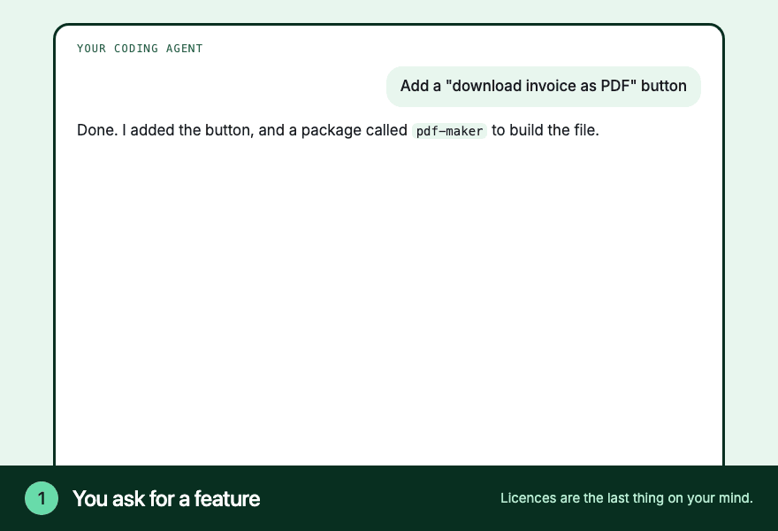
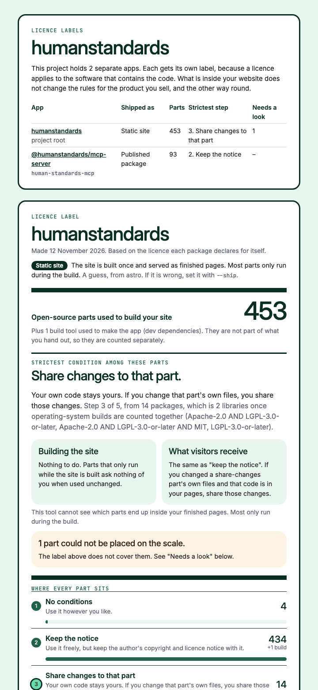
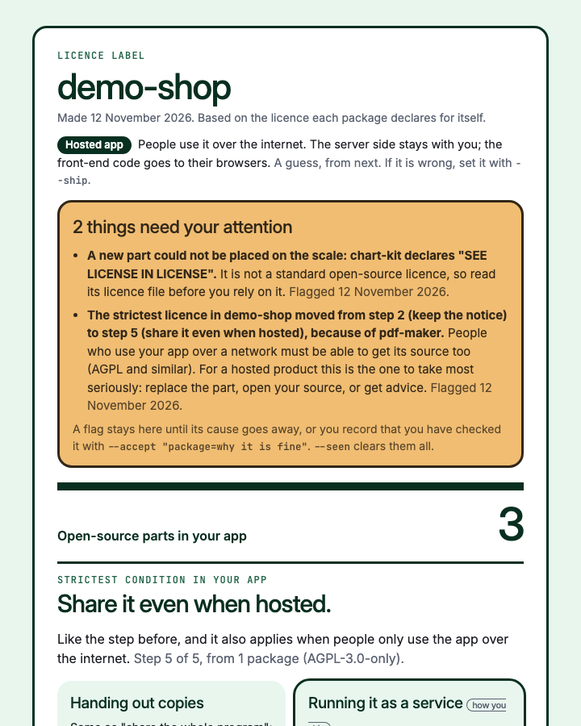

# Licence label

**A nutrition label for the open-source licences inside your app.**

Apps are built from hundreds of other people's packages, and each one comes with a licence. Most say "use this, keep my name on it". A few say "share your changes". A rare few say "share your whole app". Licence label reads them all and gives you one page:

- how many open-source parts are inside your app
- the **strictest** licence among them, in plain words
- what that means for **how you ship** (a hosted app, a download, a static site or a published package)
- the short list of things you actually have to do
- anything it could not read, so a person can look

It is made for people who build apps, often with an AI coding agent, and are not licence experts. By [Justusability](https://www.justusability.com).

> Licence label reads the licence each package *declares*. Declared licences can be wrong. It is a plain-language starting point, **not legal advice**.



*The warning line and both labels are the tool's real output, from a made-up project. The agent's wording is an illustration of the flow.*

## What a label looks like



[See a full example](examples/humanstandards-license-label.html), made from the open-source [Human Standards](https://github.com/aklodhi98/humanstandards) project.

## Use it

You need Node 18 or later, which every npm project already has. There is nothing else to install and it makes no network calls unless you ask it to.

**With an AI coding agent** (Claude Code, Codex, Cursor and others that support skills):

```bash
npx skills add Justusability/license-label
```

Then ask your agent: *"What licences am I using? Can I sell this?"*

**As a Claude Code plugin**, which also refreshes the label when your dependencies change:

```
/plugin marketplace add Justusability/license-label
/plugin install license-label@justusability
```

**On its own**, from your project folder:

```bash
npx github:Justusability/license-label . -o license-label.html
```

**On GitHub**, to remake the label on every pull request and comment only when something important changes: copy [examples/workflow-license-label.yml](examples/workflow-license-label.yml) into `.github/workflows/`.

## The scale

Every package lands on one of five steps.

| Step | In plain words | Typical licences |
|---|---|---|
| 1. No conditions | Use it however you like. | 0BSD, Unlicense, CC0 |
| 2. Keep the notice | Use it freely, but keep the author's copyright and licence notice with it. | MIT, BSD, ISC, Apache |
| 3. Share changes to that part | Your code stays yours. If you change that part's own files, you share those changes. | MPL, LGPL, EPL |
| 4. Share the whole program | If you hand out the app, the whole app's source goes with it. | GPL |
| 5. Share it even when hosted | The same, and it also applies when people only use the app over the internet. | AGPL |

Anything else, such as a commercial licence, "see licence in file", source-available terms or no licence at all, is **not open source, or unknown**. It sits off the scale under "needs a look", with the first line of its licence file and any mention of the AGPL, a subscription or limits on production use.

Build tools (dev dependencies) are counted separately, because they are not part of what you hand out.

## How you ship changes the answer

The same package can ask nothing of a hosted app and a lot of a downloadable one. Each label is written for one of four ways of shipping:

| `--ship` | Means | The label talks about |
|---|---|---|
| `hosted` | People use it over the internet | handing out copies versus running a service |
| `copies` | People download or install it | handing out copies |
| `static` | A site built once and served as finished pages | building the site versus what visitors receive |
| `package` | A library or tool others install | what you hand out versus what your users inherit |

The tool guesses from `package.json` and says on the label that it is a guess. Set it with `--ship static`, or keep it in a `license-label.config.json` file:

```json
{ "apps": { ".": { "ship": "hosted", "name": "My product" }, "website": { "ship": "static" } } }
```

A project with more than one app (say, a product and a marketing site) gets **one label per app**. A licence applies to the software that contains the code, so what is inside your website does not change the rules for the product you sell.

## It speaks up when something changes

Make the label once and commit it. After that, each run compares with the last one and raises a flag for four things only, so a flag always means something:

1. the strictest step went up
2. a new part arrived at step 4 or 5
3. a new part cannot be placed on the scale (commercial, unknown, no licence)
4. a part you already had now declares a stricter licence, which usually arrives through a routine update



- **In Claude Code**, the plugin checks after each turn in which your lockfile changed. If something is flagged, you see a one-line warning and your agent tells you what changed, what it means for how you ship, and what you can do.
- **On the label**, open flags sit in an amber box at the very top.
- **On GitHub**, the Action comments on the pull request.

A flag stays open until its cause goes away, or you record that you have checked it:

```bash
license-label --accept "some-package=we have a commercial licence for this"
```

That is saved in `license-label.config.json` with the date and the licence the package declared. If the package later declares a different licence, you are asked again.

## Options

```
license-label [project folder] [options]

  -o, --out FILE       HTML file to write (default: license-label.html)
      --name NAME      project name shown on the label
      --ship HOW       hosted, copies, static or package (folder=HOW for one folder)
      --notices FILE   collect the licence texts of your app's packages into one file
      --summary FILE   write a short Markdown summary (for pull-request comments)
      --verify         ask deps.dev for a second opinion on each package (online)
      --online         look up Python licences on pypi.org when packages are not installed
      --accept "NAME=WHY"  record that you checked a package and it is fine
      --seen           clear the open flags
      --fail-above N   exit with code 2 if an app goes beyond step N or has unknowns,
                       not counting packages you have recorded as checked
      --if-changed     only refresh an existing label, and only if a lockfile changed
```

It writes `license-label.html` and a `license-label.json` beside it. Commit both: the JSON is how the next run tells you what changed, for example "the strictest step moved from *keep the notice* to *share it even when hosted*".

`--verify` and `--online` send your package names and versions to deps.dev (run by Google) or pypi.org. Everything else runs on your machine.

## What it reads

- **npm:** `package-lock.json`, which records the licence of every package, including the indirect ones.
- **yarn, pnpm, bun:** it follows `package.json` through what is installed in `node_modules`.
- **Python:** `requirements*.txt`, `pyproject.toml`, `uv.lock`, `poetry.lock` and `Pipfile.lock`, plus an installed `.venv`. Python lockfiles do not record licences, so install the project first or use `--online`.

## What it cannot see

- Code, fonts, images or snippets **copied into your folders**, including code an AI assistant wrote or pasted in.
- The terms of **online services** your app calls.
- Which packages end up **in the browser, in your finished pages or in your published files**. It only knows what is marked as a build tool.
- Whether a declared licence is **true**. It does not scan every file. `--verify` compares against one public index, which is a second opinion and not proof.

If something sits at step 4 or 5, is unknown, or matters commercially, read the licence and ask a lawyer.

## How it compares

Finding and listing licences is well covered by tools such as `license-checker`, `pip-licenses`, GitHub's dependency graph, deps.dev, ScanCode, the OSS Review Toolkit, FOSSA and Snyk. They are built for developers and compliance teams, and most give a list of licence names or a pass/fail against a policy you write yourself.

Licence label does the part after that: it turns the list into one page a non-expert can act on. If you have a legal team, use their tools and their advice.

## Development

```bash
npm test
```

One file, no dependencies: [skills/license-label/scripts/license-label.js](skills/license-label/scripts/license-label.js). The licence grouping is a short table at the top of that file. Corrections are welcome, especially to the wording, which matters more than the code.

"Licence" is the Australian spelling and is used in the text. The install name is `license-label` because that is what most people search for. Both commands work.

## Licence

[MIT](LICENSE). Its own label: step 2, keep the notice, and no dependencies.
